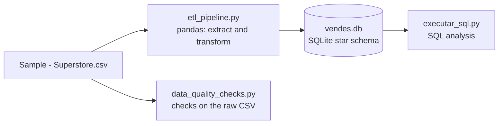

# Retail Data Warehouse Pipeline (Python, pandas, SQLite)

> **Fork of [marccass/Retail-Data-Warehousing-Project-Python-SQL](https://github.com/marccass/Retail-Data-Warehousing-Project-Python-SQL)** (MIT licence). The ETL pipeline and SQL analysis were written by the original author. My additions are listed in [What I added](#what-i-added).

## What this project does

It takes the Superstore sales CSV (9,994 order rows) and turns it into a small data warehouse in SQLite using a **star schema**. It then runs SQL queries on that warehouse to answer business questions, such as which products and categories are most profitable.

## Original work vs my additions

| | Original author | Me |
|---|---|---|
| ETL pipeline (`scripts/etl_pipeline.py`) | Yes | Read, run and analysed |
| Star schema and SQL analysis | Yes | Ran and studied |
| Data quality check script | | Yes |
| `.gitignore` | | Yes |
| Findings on data issues | | Yes |

## Architecture



Star schema tables:
- **Fact table:** `fact_vendes` (one row per order line: order ID, dates, ship mode, customer ID, product ID, postal code, sales, quantity, discount, profit)
- **Dimension tables:** `dim_clients` (customers), `dim_productes` (products), `dim_llocs` (locations)

The table and message names are in Catalan because the original author wrote them that way (vendes = sales, clients = customers, productes = products, llocs = places).

## Tech stack

Python 3.10, pandas, SQLAlchemy, SQLite

## Project structure

```
data/                    Sample - Superstore.csv
scripts/
  etl_pipeline.py        Extract, transform and load into SQLite (original)
  executar_sql.py        Runs the SQL analysis (original)
  data_quality_checks.py Checks on the raw CSV (mine)
consultes_negoci.sql     Business SQL queries (original)
marge_benefici.png       Profit margin chart (original)
requirements.txt         pandas, sqlalchemy
vendes.db                SQLite database rebuilt by the ETL
```

## How to run (Windows, PowerShell)

```powershell
python -m venv venv
.\venv\Scripts\Activate.ps1
pip install -r requirements.txt
python scripts/etl_pipeline.py
python scripts/executar_sql.py
python scripts/data_quality_checks.py
```

## Sample output

ETL run (messages are in Catalan):

```
Clients únics: 793
Productes únics: 1862
Vendes totals: 9994
```

Profit margin by category from the SQL analysis:

| Category | Margin % |
|---|---|
| Technology | 17.40 |
| Office Supplies | 17.04 |
| Furniture | 2.49 |

Furniture has a much lower margin than the other two categories. The data alone doesn't tell us why.

## What I added

`scripts/data_quality_checks.py` reads the raw CSV and runs 11 checks: required columns, duplicate rows, missing values, valid dates, ship date not before order date, non-negative sales, positive quantity, discount between 0 and 1, and whether each customer ID, product ID and postal code maps to a single name or place. It prints PASS, WARN or FAIL for each check.

Result on the Superstore CSV: 9 passed, 2 warnings, 0 failed.

## Data issues found

- **32 Product IDs are used for more than one product name.** For example, one ID appears as both a bookcase and a library. The pipeline keeps only the first name per Product ID, so product-level results for these IDs may be attributed to the wrong product.
- **Postal code 92024 appears with two city names** (San Diego and Encinitas). Only one is kept in the locations table.

These are documented, not fixed.

## Limitations

- The pipeline does a full reload on every run (`if_exists='replace'`), not an incremental load.
- No primary or foreign keys are defined in the database.
- The `vendes.db` file is committed to the repository and changes whenever the ETL runs.
- The data is a local CSV file. There is no cloud component.

## Possible next steps (planned, not done)

- Fix the product dimension with a surrogate key.
- Define primary and foreign keys.
- Learn how this pipeline would map to Azure (ADLS Gen2 and Data Factory). I have not built anything in Azure.

## Credits and licence

Original project by [marccass](https://github.com/marccass/Retail-Data-Warehousing-Project-Python-SQL), MIT licence (see `LICENSE`). Data quality checks and README changes by [ByteInsight-123](https://github.com/ByteInsight-123).
